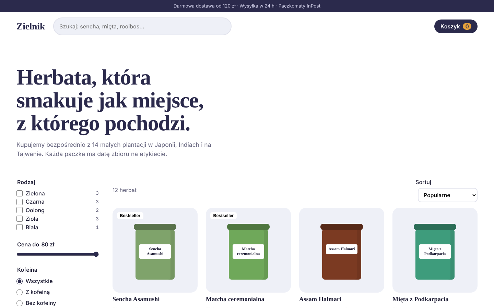

# Zielnik: online tea shop (front-end)

**Live demo:** https://andriu-tsap.github.io/sklep-herbaty/

A complete e-commerce front-end for a small online shop (concept project, fictional brand): catalogue, filters, product page, cart and checkout. A good base for a Shopify/WooCommerce theme or a custom shop.

## Features
- **Catalogue with live filtering:** search, categories with counts, price slider, caffeine filter, sorting (popular, price, newest harvest), correct Polish plurals ("1 herbata / 3 herbaty / 12 herbat")
- **Product dialog** with origin, tasting notes, brewing guide and pack sizes (50 / 100 / 250 g) priced per size
- **Slide-in cart** with quantity steppers, remove, and a **free-shipping progress bar** (free from 120 zł)
- **Cart saved in localStorage**, survives page reloads
- **Checkout:** InPost parcel locker (with code validation), DPD courier or pickup; BLIK, card or bank transfer; live total incl. shipping; order confirmation with order number
- Accessible: native `<dialog>`, focus management, Escape closes the cart, keyboard-friendly controls

## Tech
HTML5 · CSS3 (Grid, `:has()`, `color-mix()`) · vanilla JavaScript (ES6+), no dependencies

## Run locally
Open `index.html` in a browser.

---
Design and code: [Andrii Tsap](https://andriu-tsap.github.io). Shop, products and prices are fictional; no payment is taken.
